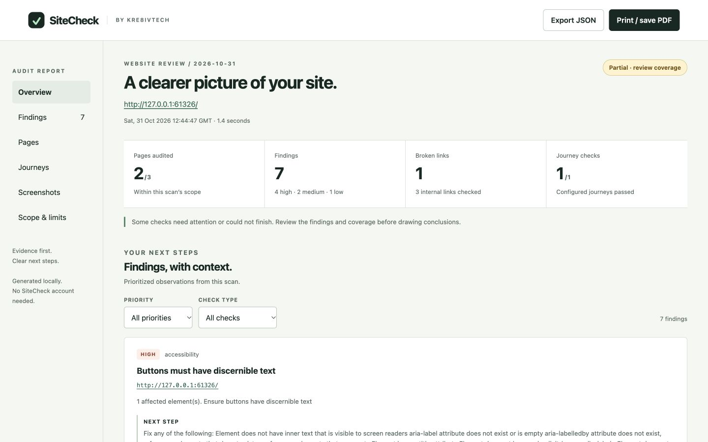

# SiteCheck

**A clearer picture of your website.**

SiteCheck is an open-source, local website auditing tool by [Kre8ivTech](https://www.kre8ivtech.com). It checks a bounded set of pages, gathers evidence, and gives you a readable report with practical next steps.

For developers, agencies, and website owners who want to catch problems before their customers do.



## What works today

- **Accessibility:** axe-core checks for WCAG 2 A/AA and 2.1 A/AA, with affected selectors, HTML examples, and rule guidance.
- **Links:** same-origin link checks, HTTP failures, and explicit “unverified” results when access or redirects prevent verification.
- **Metadata:** missing page titles, missing descriptions, missing main headings, and duplicate titles within the scanned pages.
- **Journey checks:** verify that configured pages load and expected elements are visible, such as a contact form's labeled email field.
- **Evidence:** desktop screenshots and a self-contained HTML report with priority/category filters, JSON export, and print-to-PDF support.
- **Comparison:** new, persisting, resolved, and not-reverified findings against a previous JSON report. An unvisited page is never treated as a successful fix.
- **Automation:** predictable exit codes and configurable severity thresholds for CI.

**Version 0.1.0 is an early release.** It is a command-line scanner with an HTML report, not a hosted dashboard. No account, AI API key, or SiteCheck telemetry is required.

## Quick start

Requires Node.js 22 or newer and Chromium dependencies supported by Playwright.

```sh
git clone https://github.com/Kre8ivTech/sitecheck.git
cd sitecheck
npm ci
npx playwright install chromium
npm run build
node dist/cli.js https://www.example.com --output reports/my-site
```

On Linux CI, install system dependencies too: `npx playwright install --with-deps chromium`.

Open `reports/my-site/report.html` in a browser. It includes the page screenshots and works without a report server. The same folder contains `report.json` and separate screenshot files.

This package is not yet published to npm. The commands above run from source.

## Try a working demo

```sh
npm run demo
```

This starts a temporary fictional studio website, scans deliberate problems, repairs them, and produces:

- `reports/demo/report.html` — the original findings.
- `reports/demo-after/report.html` — the follow-up report, including the comparison.

The temporary target server closes when generation finishes; its page links are not a live public website. Both reports remain usable.

## Configure your scan

Copy [`sitecheck.example.json`](sitecheck.example.json) and edit the URL, paths, and journey expectations.

```sh
node dist/cli.js --config sitecheck.example.json
```

```json
{
  "url": "https://www.example.com/",
  "maxPages": 5,
  "maxLinks": 50,
  "timeout": 15000,
  "output": "reports/example",
  "paths": ["/contact"],
  "exclude": ["/admin", "/account"],
  "journeys": [
    {
      "name": "Contact form is available",
      "steps": [
        { "path": "/", "expect": "nav a[href='/contact']" },
        { "path": "/contact", "expect": "form input[type='email']" }
      ]
    }
  ]
}
```

`expect` is a CSS selector whose first match must become visible. These checks visit pages directly; they do not click through a funnel, submit a form, verify email delivery, or complete a payment.

CLI values override config values. Run `node dist/cli.js --help` for all flags.

| Setting | Default | Limit |
| --- | --- | --- |
| Pages | 5 | 1–25 |
| Checked links | 50 | 1–200 |
| Operation timeout | 15 seconds | 1–60 seconds |
| Journeys | None | 5 journeys, 10 steps each |
| Private networks | Blocked | Explicit `--allow-private` for trusted targets |

Seed paths are added after the starting URL. Discovered same-origin HTML links are processed in order until the page limit is reached. Exclusions are path prefixes. `robots.txt` exclusions apply to pages, link checks, and journeys; crawl delays up to 60 seconds are honored between target page/link requests. A missing robots.txt (404/410) allows scanning; other failures stop the scan. A longer crawl delay stops the scan rather than being ignored.

## Compare two runs

```sh
node dist/cli.js https://www.example.com --output reports/before
# Make your website changes.
node dist/cli.js https://www.example.com --output reports/after \
  --baseline reports/before/report.json
```

Comparisons require the same origin and report schema. Findings are grouped by category, rule, and page URL. “Resolved” means the relevant check ran again without that finding; it does not mean a person has verified the entire page. Pages not rechecked remain “not reverified.” Comparisons track rule/page groups, not individual DOM elements.

## Use in CI

```sh
node dist/cli.js https://staging.example.com --fail-on high --output reports/ci
```

| Exit | Meaning |
| --- | --- |
| `0` | Scan completed with no findings at or above the selected threshold. |
| `1` | Scan completed and findings reached the threshold. |
| `2` | Configuration/runtime error, or a partial scan with unavailable checks. |

`--fail-on` accepts `high` (default), `medium`, `low`, or `none`. Partial scans still exit `2` even with `--fail-on none`, so incomplete coverage cannot silently pass. A scoped scan completing does not mean the entire site was tested.

## Scope and limitations

- Scan websites you own or have permission to check. Expect normal GET/HEAD traffic and the target page's own browser requests.
- The scanner uses a fresh browser context, blocks non-GET/HEAD browser requests, service workers, popups, and WebSockets, and does not use your personal browser login.
- Only same-origin, non-query links are discovered and checked. External destinations, fragments, authenticated areas, sitemaps, and exhaustive crawling are outside this release.
- Navigation redirects must remain on the starting origin. Use the website's final canonical URL, including `www` when needed.
- A 401, 403, 429, unresolved redirect, or network error is unverified, not proof of a broken link. A 404/other HTTP failure can be reported as broken.
- Accessibility checks are automated and run at a desktop viewport (1440 × 900). Manual keyboard/screen-reader review, mobile testing, and inclusive user testing remain necessary. SiteCheck does not certify WCAG compliance, security, search rankings, or business outcomes.
- Late-loading, consent-gated, or POST-dependent content may not be available. The load event is the capture point; a site's behavior may differ in an unrestricted user session.
- Reports include URLs, snippets of rendered HTML, and screenshots. Review output before publishing it. SiteCheck has no telemetry, but third-party scripts on the scanned website can contact their own services.
- The private-address guard is defense in depth for a local tool. DNS resolution and browser networking are separate; this is **not** a hardened SSRF boundary. Do not put this CLI behind an unrestricted public scanning endpoint. Use isolated workers and enforced network egress controls for a future hosted service.

## Develop

```sh
npm ci
npx playwright install chromium
npm run check
npm run demo
```

`npm run check` runs TypeScript checks, tests against a real local HTTP fixture and Chromium, and a production build. No external website is required for tests.

The code is intentionally small:

| File | Responsibility |
| --- | --- |
| `src/cli.ts` | Arguments, progress, and exit codes |
| `src/config.ts` | Configuration validation and limits |
| `src/network.ts` | Private-address checks and bounded redirects |
| `src/scanner.ts` | Crawl, audit, screenshots, links, and journeys |
| `src/findings.ts` | Stable finding identities and comparisons |
| `src/report.ts` | Accessible, responsive, self-contained HTML output |

## Roadmap

The next priorities are configurable viewport coverage, richer journey evidence, and a reusable GitHub Action. A hosted scanning service would require a separate security and operations design.

Ideas and focused contributions are welcome. Read [CONTRIBUTING.md](CONTRIBUTING.md) and report vulnerabilities through [SECURITY.md](SECURITY.md).

## License

MIT © 2026 Kre8ivTech, LLC. See [LICENSE](LICENSE).

Built by [Kre8ivTech](https://www.kre8ivtech.com) · Creativity, engineered.
